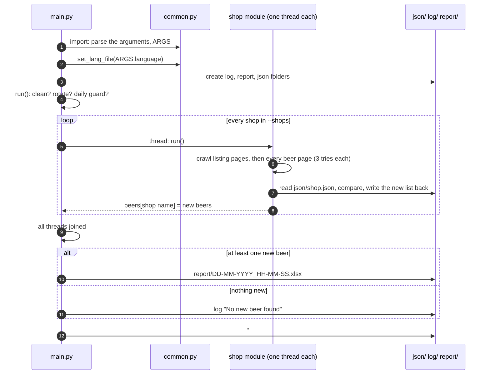

# Architecture Overview

Beer Crawler is a Python 3.10+ script that visits five Hungarian craft beer web shops, remembers what it saw, and writes only the **new** beers into an Excel report. This page is the entry point to the technical documentation: how the project is laid out, what happens during a run and where the state lives.

| Page | What it covers |
|---|---|
| [Shop Crawlers](shop-crawlers.md) | The shared crawl pattern, the `Beer` object, what each of the five shop modules reads, the new-beer comparison, the name cleanup |
| [Command Line, GUI & Docker](command-line-gui-and-docker.md) | Every argument, the tkinter GUI, files and folders the script writes, rotation, the daily guard, the Docker image |
| [Recommendations](recommendations.md) | Bugs and cleanups found while reading the code |
| [Guides](guides/README.md) | Step by step: a new shop, a new language |

The pages describe the code as it is. Suggested changes are collected on [Recommendations](recommendations.md).

---

## Design principles

* **One module per shop.** A shop module knows one site and nothing else. It returns the list of beers that are new to it.
* **Shared helpers in one place.** `modules/common.py` holds the argument parser, logging, JSON helpers, the HTML helpers and the text cleanup. Importing it also parses the command line (`ARGS`).
* **State is plain JSON.** The previous crawl of every shop is a JSON file; "new" means "not in that file". No database.
* **Threads per shop.** Every shop is crawled in its own thread; the report is written when all are done.
* **Every text is a key.** What the script prints or shows in the GUI comes from `lang/<code>.json`.

---

## Folder layout

```
main.py               Entry point: threads per shop, Excel report, tkinter GUI
modules/
  common.py           Arguments, logging, JSON, HTML helpers, name cleanup, language files, version
  beerselection.py    Crawler for beerselection.hu
  csakajosor.py       Crawler for csakajosor.hu
  onebeer.py          Crawler for onebeer.hu
  drinkstation.py     Crawler for drinkstation.hu
  beerbox.py          Crawler for beerbox.hu (needs an age-gate cookie)
lang/                 en.json, hu.json: every text of the script
docs/                 GUI screenshot, README for the Docker Hub page
Dockerfile            python:3.14-slim image, runs `python /main.py`
.docker               name=beercrawler, version=2.14 (read by the build tooling, not by the script)
```

At run time the script creates three folders next to `main.py` (`/` in the Docker image): `log/`, `report/` and `json/`. All three are git-ignored.

---

## What happens in a run



## Where the state lives

| File | Written by | Meaning |
|---|---|---|
| `json/<shop>.json` | each shop module | The beers seen at the last crawl of that shop. Rewritten on every run, **even when nothing is new**. The next run compares against it. Missing = first run: every beer counts as new |
| `log/DD-MM-YYYY.log` | `log_and_print()` | Time stamped lines of the day. A line `#` means "a run finished today" and is what `--daily` looks for |
| `report/DD-MM-YYYY_HH-MM-SS.xlsx` | `create_worksheet()` | One sheet, one row per new beer, only when something is new |

## Dependencies

`requests`, `beautifulsoup4`, `html5lib`, `lxml`, `XlsxWriter`; `tkinter` only for the GUI. The Dockerfile installs them unpinned (`pip install requests html5lib lxml beautifulsoup4 XlsxWriter`).
